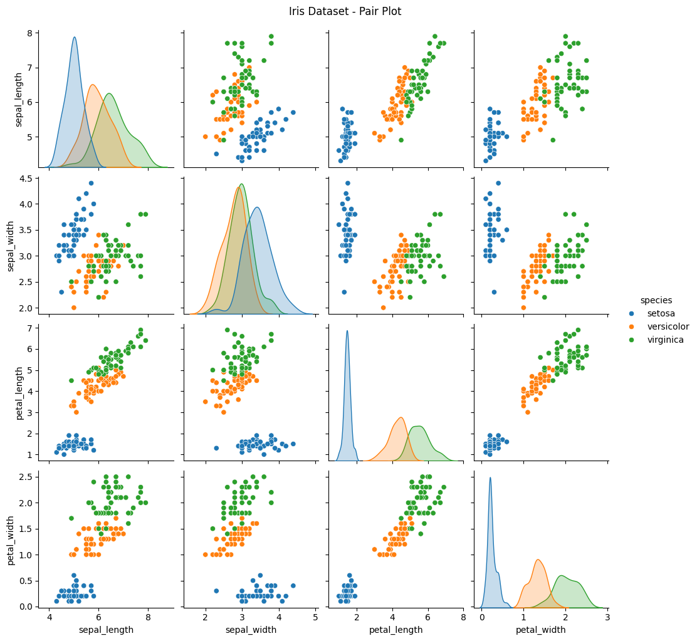
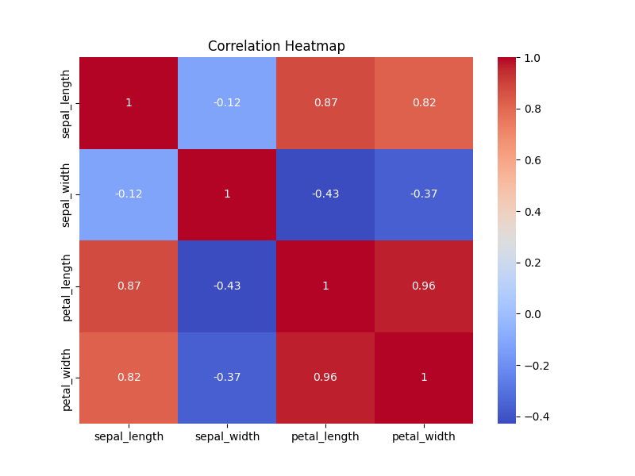
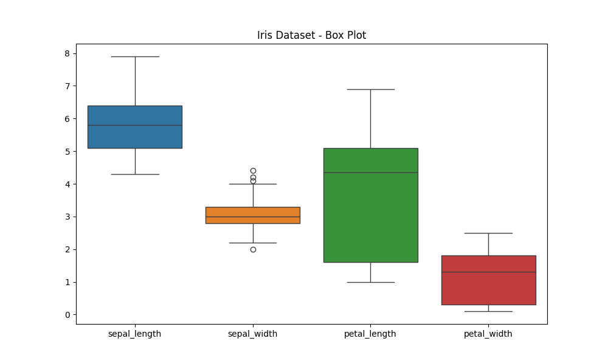

# CodeAlpha Internship – Task 2: Exploratory Data Analysis (EDA)

## Project Overview
This project performs Exploratory Data Analysis on the Iris dataset using Python.

## Dataset
Iris Dataset (`iris.csv`)

## Tools and Libraries
- Python
- Pandas
- NumPy
- Matplotlib
- Seaborn
- SciPy

## Analysis Performed
- Displayed the first five rows.
- Checked dataset information and shape.
- Identified missing and duplicate values.
- Generated statistical summaries.
- Analyzed species counts.
- Calculated correlation.
- Performed hypothesis testing using ANOVA.
- Created Pair Plot, Correlation Heatmap, and Box Plot.

## Key Findings
- The dataset contains 150 rows and 5 columns.
- No missing values were found.
- One duplicate row was identified.
- Each species contains 50 records.
- Petal length differs across the three species.

## How to Run
1. Install the required libraries:
   `python -m pip install pandas numpy matplotlib seaborn scipy`
2. Run the Python file:
   `python eda.py`

## Conclusion
EDA helped identify patterns, relationships, and differences among Iris flower species using statistical analysis and visualizations.

## Graph Outputs

### 1. Pair Plot

### 2. Correlation Heatmap

### 3. Box Plot

